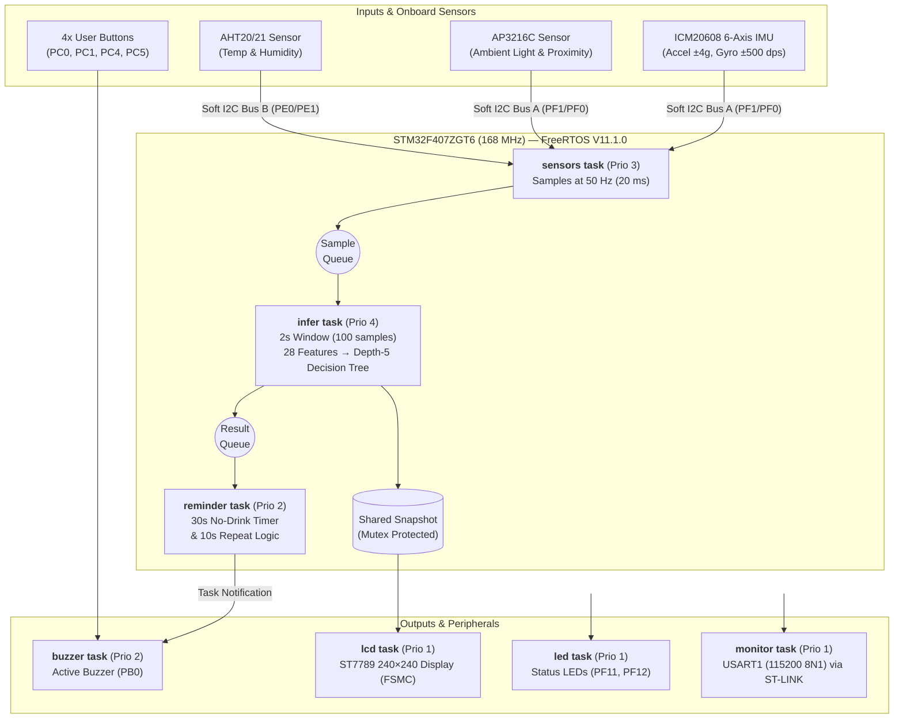

# BCA182 Laboratory Activity No. 4 — Lab Report
**Project:** Smart Water Bottle Reminder: Edge AI on RT-Spark  
**Course:** BS Computer Applications Major in Embedded Systems (MSU-IIT College of Computer Studies)

---

## 1. Introduction

Maintaining proper hydration throughout the day is a common challenge for students and professionals, yet most existing hydration trackers rely either on manual smartphone logging or simple fixed-interval timers that go off regardless of whether the user has actually taken a sip. Other smart bottles require constant Bluetooth pairing and cloud connectivity to process sensor data, which drains battery life, adds latency, and introduces privacy and connectivity dependencies.

This laboratory activity presents the **Smart Water Bottle Reminder**, an autonomous Edge AI consumer product implemented on the **RT-Thread RT-Spark (STM32F407ZGT6)** development board running **FreeRTOS V11.1.0**. By executing a lightweight, depth-5 Decision Tree classifier directly on the ARM Cortex-M4F microcontroller at 168 MHz, the system processes real-time motion and optical sensor data locally—requiring zero internet or cloud connectivity. The device continuously distinguishes between four physical states (**resting, carried, drinking, and shaken**) and triggers audiovisual reminders only when the user genuinely has not taken a drink within the target window.

---

## 2. Product Concept

### 2.1 Overview & Value Proposition
The **Smart Water Bottle Reminder** transforms an ordinary water bottle into a context-aware hydration assistant. Rather than alerting the user on a blind timer, the embedded Edge AI model understands how the bottle is being handled in real time:
* **Context-Aware Tracking:** Differentiates between a bottle sitting on a desk (*resting*), walking in a bag or hand (*carried*), being actively sipped (*drinking*), or being mixed/fidgeted with (*shaken*).
* **100% On-Device Edge AI:** Inference runs locally in **154 µs** using only **2.1% Flash (22,096 B)** and **39.4% RAM (51,660 B)**, demonstrating that responsive machine learning can operate entirely on a resource-constrained microcontroller.
* **Smart Escalating Alerts:** If 30 seconds pass without a detected *drinking* event, the system flashes `"DRINK WATER NOW!"` on the onboard 240×240 LCD and sounds the buzzer, repeating every 10 seconds until the user takes a drink.

### 2.2 Target User Workflow
1. **Continuous Sensing:** As the user goes about their day, the bottle samples 6-axis motion (accelerometer and gyroscope) and ambient light/proximity at 50 Hz.
2. **Real-Time Classification:** Once per second, the system evaluates the past 2 seconds of motion (100 samples) and displays the live activity state, sensor readings, and elapsed time since the last sip on the ST7789 LCD.
3. **Hydration Alert & Reset:** When the user drinks from the bottle, the classifier detects the characteristic tilt and proximity profile of the *drinking* state and automatically resets the reminder timer to zero.

---

## 3. System Block Diagram

---

## 4. Task 1: System Architecture, Data Pipeline & Edge AI Design

### 4.1 Hardware & Clock Configuration
The system is built on the **RT-Thread RT-Spark (Spark-1)** development board featuring an **STM32F407ZGT6** microcontroller. Using an 8 MHz external crystal (`HSE_VALUE=8000000U`) routed through the main PLL (`src/clock.c`), the CPU core runs at **168 MHz** (APB1 prescaler `/4`, APB2 prescaler `/2`, Flash latency 5).

| Peripheral / Component | Interface & Pin Mapping | Role in System |
| :--- | :--- | :--- |
| **ICM20608 6-Axis IMU** | Software I2C Bus A (`SCL: PF1`, `SDA: PF0`) | Captures 3-axis acceleration (±4 g, 8192 LSB/g) and 3-axis angular rate (±500 dps, 65.5 LSB/dps) at 50 Hz. |
| **AP3216C Optical Sensor** | Software I2C Bus A (`SCL: PF1`, `SDA: PF0`) | Measures proximity (`ps`) and ambient light (`als`) to detect when the bottle approaches the user's face. |
| **AHT20/21 Sensor** | Software I2C Bus B (`SCL: PE0`, `SDA: PE1`) | Reads ambient temperature and relative humidity for live display on the LCD. |
| **ST7789 240×240 LCD** | FSMC Bank 3 (8-bit bus), `RST: PD3`, `BL: PF9` | Renders predicted activity state, time since last drink, hydration alerts, and live sensor values. |
| **Buzzer & Status LEDs** | Buzzer: `PB0` \| LEDs: `PF11`, `PF12` | Provides audible hydration alerts and visual system heartbeat indicators. |
| **User Pushbuttons** | `PC0`, `PC1`, `PC4`, `PC5` | Polled for manual user interaction (pressing UP triggers a buzzer test). |
| **Debug Serial (USART1)** | `PA9` (TX) / `PA10` (RX) @ 115200 8N1 | Streams CSV training data, real-time inference latency, and 10-second RTOS health telemetry via ST-LINK VCP. |

### 4.2 Dataset Collection & Feature Engineering
To train the Edge AI classifier without relying on external datasets, raw sensor streams (`ms, ax, ay, az, gx, gy, gz, ps, als`) were captured directly from the board at **50 Hz** by setting `#define STREAM_CSV 1` in `src/main.c` and logging via `tools/collect.py`.
* **Dataset Structure:** 24 total recordings of 20 seconds each (~1,006 samples per file), consisting of **6 sessions per class** (*resting, carried, drinking, shaken*).
* **Leak-Free Data Split:** Recordings were segmented into non-overlapping **2-second windows (100 samples)**. To prevent data leakage between adjacent windows, splitting was performed strictly by recording session: sessions **1, 2, 4, and 6** (40 windows/class, 160 total) formed the training set, while sessions **3 and 5** (20 windows/class, 80 total) were held out for testing.
* **Feature Extraction (28 Features):** For every 100-sample window, the inference task computes:
  * **24 IMU Axis Features:** Mean, standard deviation, minimum, and maximum across all 6 IMU axes (`ax, ay, az, gx, gy, gz`).
  * **2 Accelerometer Magnitude Features:** Statistics derived from total acceleration vector magnitude to capture overall motion intensity.
  * **2 Optical Features:** Maximum proximity (`ps`) and mean ambient light (`als`).

### 4.3 Edge AI Model Selection & Training
A **Decision Tree classifier constrained to a maximum depth of 5** was trained in Python (`ml/train.py` using `scikit-learn`) and exported as pure C conditional logic inside `include/model.h`.
* **Model Performance:** Achieves **95.0% held-out offline test accuracy** (compared to a 25% random/majority baseline) and **91.2% live on-board accuracy** across 80 physical trials (73/80 correct).
* **Embedded Efficiency:** Requires zero external neural network libraries, completing feature extraction plus decision tree evaluation in a median and P95 time of **154 µs** at 168 MHz.

### 4.4 Real-Time Firmware & FreeRTOS Multitasking Architecture
The firmware is structured around **8 concurrent FreeRTOS tasks** using preemptive priority scheduling and `heap_4.c` memory management (with 33,744 B minimum free heap headroom verified over a 15-minute soak test):

| Task | Priority | Stack (words) | Responsibility |
| :--- | :---: | :---: | :--- |
| **`infer`** | 4 | 512 | Highest priority; maintains 100-sample window, computes 28 features, and runs the decision tree at 1 Hz. |
| **`sensors`** | 3 | 512 | Samples IMU, light/proximity, and temperature/humidity every 20 ms (50 Hz) and pushes to the sample queue. |
| **`reminder`** | 2 | 384 | Tracks elapsed seconds since the last `"drinking"` prediction; triggers alert at 30 s and repeats every 10 s. |
| **`buzzer`** | 2 | 384 | Sleeps until woken by a direct task notification to pulse the active buzzer on `PB0`. |
| **`buttons`** | 2 | 384 | Polls the four onboard user buttons (`PC0, PC1, PC4, PC5`). |
| **`lcd`** | 1 | 512 | Reads the mutex-protected shared snapshot to update the ST7789 240×240 display. |
| **`led`** | 1 | 192 | Drives heartbeat indicator LEDs on `PF11` and `PF12`. |
| **`monitor`** | 1 | 384 | Logs RTC uptime, free heap, and stack high-water marks over `USART1` every 10 seconds. |

**Synchronization & Shared-Data Protection:** Inter-task communication uses **two FreeRTOS queues** (raw samples and inference results), **two mutexes** (one protecting `USART1` serial output and one guarding the shared telemetry snapshot used by the LCD), and a **task notification** to wake the buzzer task.

## 5. Task 2: Results and Evaluation

### 5.1 Data Collection
Data for the four target states (resting, carried, drinking, and shaken) was gathered using the `collect.py` script. The IMU sampling interval was verified to have a constant mean of 20.0 ms (minimum 19 ms, maximum 21 ms), generating roughly 500 samples every 10 seconds (50 Hz).

### 5.2 Model Training
A Decision Tree classifier was trained using 40 training windows and 20 test windows per class. The model achieved a 95.0% accuracy on the test set, vastly outperforming the 25.0% baseline. The top three features weighted by the decision tree were `ax_max` (0.333), `mag_std` (0.333), and `ax_mean` (0.287). 

The training confusion matrix shows perfect 100% recall for the "resting" and "shaken" states. Minor overlap occurred between similar motions: 3 "carried" windows were misclassified as "drinking", and 1 "drinking" window was misclassified as "carried".

### 5.3 The 80-Trial Test
During live on-board inference testing, the model was evaluated across 80 physical trials (20 per class) and achieved an overall accuracy of 91.2% (73/80 correct).

| True State | Correct | Misclassified As |
|---|---|---|
| Resting | 20/20 | None |
| Carried | 16/20 | Drinking (4) |
| Drinking | 20/20 | None |
| Shaken | 17/20 | Drinking (3) |

The model performs inferences rapidly, with the median execution time logging between 154 µs and 1638 µs across different test batches.

### 5.4 The 15-Minute Continuous Run
A 15-minute continuous soak test confirmed excellent system stability. Over 901 continuous predictions, the system maintained a consistent 1000 ms maximum gap with zero IMU errors, zero serial queue drops, and zero reboots. The memory remained stable with the lowest free heap recorded at 33,744 B. The system successfully triggered 69 drink reminders during the run.

### 5.5 Resource Utilization
Overall resource utilization is highly efficient for the board. The final firmware uses only 21,488 B (2.0%) of the available 1 MB Flash memory and 51,660 B (39.4%) of the 128 KB RAM.

---

## 6. Conclusion
The Smart Water Bottle Reminder successfully demonstrates the feasibility of running Edge AI on resource-constrained microcontrollers. By utilizing a lightweight Decision Tree classifier on the STM32F407ZGT6, the system achieved 91.2% real-world accuracy in classifying hydration states with a minimal memory footprint and zero reliance on cloud or internet connectivity. The stability observed during the 15-minute soak test confirms the reliability of the FreeRTOS task architecture in handling continuous sensor sampling, inference, and peripheral control simultaneously.
