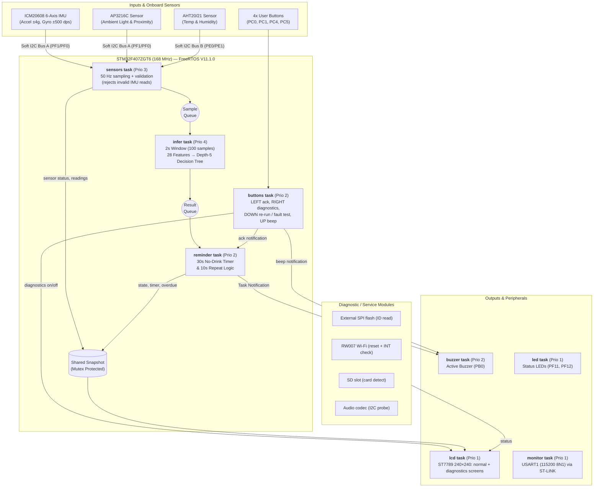
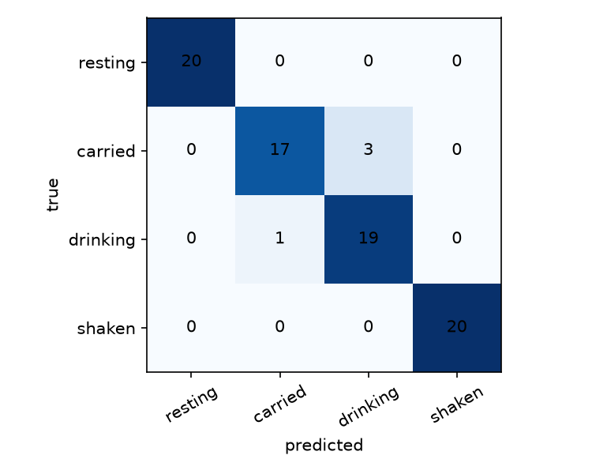

[LAB_REPORT.md](https://github.com/user-attachments/files/33901624/LAB_REPORT.md)
# BCA182 Laboratory Activity No. 4 — Lab Report
**Project:** Smart Water Bottle Reminder: Edge AI on RT-Spark  
**Course:** BCA182 Embedded Systems Programming Laboratory, Laboratory Activity No. 4 (MSU-IIT College of Computer Studies, BS Computer Applications)  
**Instructor:** Asst. Prof. Paul Rodolf P. Castor

---

## 1. Introduction

Maintaining proper hydration throughout the day is a common challenge for students and professionals, yet most existing hydration trackers rely either on manual smartphone logging or simple fixed-interval timers that go off regardless of whether the user has actually taken a sip. Other smart bottles require constant Bluetooth pairing and cloud connectivity to process sensor data, which drains battery life, adds latency, and introduces privacy and connectivity dependencies.

This laboratory activity presents the **Smart Water Bottle Reminder**, an autonomous Edge AI consumer product implemented on the **RT-Thread RT-Spark (STM32F407ZGT6)** development board running **FreeRTOS V11.1.0**. By executing a lightweight, depth-5 Decision Tree classifier directly on the ARM Cortex-M4F microcontroller at 168 MHz, the system processes real-time motion and optical sensor data locally—requiring zero internet or cloud connectivity. The device continuously distinguishes between four physical states (**resting, carried, drinking, and shaken**) and triggers audiovisual reminders only when the user genuinely has not taken a drink within the target window.

---

## 2. Product Concept

### 2.1 Overview & Value Proposition
The **Smart Water Bottle Reminder** transforms an ordinary water bottle into a context-aware hydration assistant. Rather than alerting the user on a blind timer, the embedded Edge AI model understands how the bottle is being handled in real time:
* **Context-Aware Tracking:** Differentiates between a bottle sitting on a desk (*resting*), walking in a bag or hand (*carried*), being actively sipped (*drinking*), or being mixed/fidgeted with (*shaken*).
* **100% On-Device Edge AI:** Inference runs locally in **154 µs** using about **24 KB of Flash (roughly 2%)** and **51.7 KB of RAM (39.5%)** for the application and model, demonstrating that responsive machine learning can operate entirely on a resource-constrained microcontroller.
* **Repeating Alerts:** If 30 seconds pass without a detected *drinking* event, the system flashes `"DRINK WATER NOW!"` on the onboard 240×240 LCD and sounds the buzzer, repeating every 10 seconds until the user takes a drink or presses LEFT to acknowledge.

### 2.2 Target User Workflow
1. **Continuous Sensing:** As the user goes about their day, the bottle samples 6-axis motion (accelerometer and gyroscope) and ambient light/proximity at 50 Hz.
2. **Real-Time Classification:** Once per second, the system evaluates the past 2 seconds of motion (100 samples) and displays the live activity state, sensor readings, and elapsed time since the last sip on the ST7789 LCD.
3. **Hydration Alert & Reset:** When the user drinks from the bottle, the classifier detects the characteristic tilt-and-motion profile of the *drinking* state and automatically resets the reminder timer to zero. The user can also press **LEFT** to acknowledge a reminder and reset the timer by hand.

### 2.3 Alternative Ideas Considered

| Alternative | Why not chosen |
|---|---|
| **Fall / drop detector** for a bottle or small object | Only two useful states (still vs. dropped). A drop is hard to repeat safely and often, so we could not collect enough test data. |
| **Desk posture / sedentary reminder** (IMU + light) | The board sits on a desk, not on the body, so the sensors cannot observe posture. |
| **Smart Water Bottle Reminder (chosen)** | Four states we can repeat safely 20+ times each, uses the IMU motion data directly, and the output (a reminder) is easy to observe. |

### 2.4 Component-to-Function Matrix

| Component | Interface | Category | Used for |
|---|---|---|---|
| ICM20608 IMU | Soft I2C bus A, 0x68 | **Primary sensing** | Motion for the 4-state classifier (50 Hz) |
| AP3216C (proximity + light) | Soft I2C bus A, 0x1E | Context sensing | Proximity and light are recorded and shown on the LCD. The deployed tree does not use them (see 5.2); the rule baseline in 5.7 does use proximity |
| AHT20/21 (temp, humidity) | Soft I2C bus B, 0x38 | Context sensing | Shown on the LCD |
| ST7789 LCD 240x240 | FSMC bank 3 | User interaction | State, timer, reminder, diagnostics screen |
| Buzzer | PB0 | User interaction | Reminder beep, button feedback |
| Status LEDs | PF11, PF12 | User interaction | Heartbeat |
| Buttons (LEFT/RIGHT/DOWN/UP) | PC0, PC4, PC1, PC5 | User interaction | LEFT: acknowledge/reset reminder. RIGHT: diagnostics on/off. DOWN: re-run checks (diagnostics screen) or start the 10 s sensor-fault test (normal screen). UP: buzzer test |
| RTC (LSE 32.768 kHz) | On-chip | Logging / communication | Timestamp in serial log, shown on the diagnostics screen |
| USART1 via ST-LINK | PA9/PA10, 115200 | Logging / communication | Inference log, health report, data collection |
| External SPI flash | SPI2: SCK PB13, MISO PC2, MOSI PC3, CS PB12 | Diagnostic / service | JEDEC ID read on the diagnostics screen: `EF4017` (Winbond W25Q64, 8 MB) |
| Wi-Fi module RW007 | SPI2, CS PF10, RST PG15, INT PG11 | Diagnostic / service | Reset + INT response check: "READY". Not used for communication (offline by design) |
| SD card slot | SDIO, card-detect PF3 | Diagnostic / service | Card-detect read: "NO CARD" (no card fitted) |
| Audio codec | Soft I2C bus A, 0x10 | Diagnostic / service | I2C address probe: "OK". Audio not used |

Notes:
- The schematic labels the flash W25Q128, but the chip on our board reports ID `EF4017` (W25Q64). We report what the hardware returned.
- No SD card is fitted. The slot itself is checked, and the diagnostics screen shows "NO CARD".

### 2.5 Acceptance Criteria and Risks

| Item | Criterion | Result |
|---|---|---|
| Behavior | Show one of 4 states about once per second; remind after 30 s without drinking; repeat every 10 s | Met (LCD + 15-minute run) |
| Accuracy | At least 90% on 80 live trials (20 per state) | 91.2% (73/80). Met, by a narrow margin |
| Cost of errors | Most costly error: a non-drinking motion read as "drinking", because it resets the timer and delays a reminder | All 7 live errors were of this kind (4 carried and 3 shaken read as drinking) |
| Speed | Inference under 1 ms | 154 µs median and P95 (50 runs) |
| Stability | No crash, hang, or dropped sample in 15 minutes | 901 predictions, 0 drops, 0 IMU errors, 0 reboots |
| Offline | Works with no network for 5 minutes or more | **[CONFIRM: the current demo video is 65 s long; record a 5-minute offline run on the power bank and link it]** |
| Measurement plan | 24 labeled recordings split by session; 80 live trials; 15-minute soak; 50 timed inferences | Done |

**Privacy.** No microphone or camera is used. The device records only motion, light, and proximity numbers. Nothing leaves the device (no network). Training data are motion CSVs with no names or images, so they can be shared in the repo.

**Safety.** The product is an experimental prototype, not a medical device. It does not measure how much water is drunk and gives no health advice. A wrong reminder is a minor inconvenience, not a safety risk.

**Accessibility.** Reminders use both sound (buzzer) and sight (red "DRINK WATER NOW!" on the LCD), so a user who cannot hear or cannot see one still gets the other. Limitations: the LCD text is small, there is no vibration output, and the buzzer volume cannot be adjusted.

---

## 3. System Block Diagram

---

## 4. Task 1: System Architecture, Data Pipeline & Edge AI Design

### 4.1 Hardware & Clock Configuration
The system is built on the **RT-Thread RT-Spark (Spark-1)** development board featuring an **STM32F407ZGT6** microcontroller. Using an 8 MHz external crystal (`HSE_VALUE=8000000U`) routed through the main PLL (`src/clock.c`), the CPU core runs at **168 MHz** (APB1 prescaler `/4`, APB2 prescaler `/2`, Flash latency 5).

| Peripheral / Component | Interface & Pin Mapping | Role in System |
| :--- | :--- | :--- |
| **ICM20608 6-Axis IMU** | Software I2C Bus A (`SCL: PF1`, `SDA: PF0`) | Captures 3-axis acceleration (±4 g, 8192 LSB/g) and 3-axis angular rate (±500 dps, 65.5 LSB/dps) at 50 Hz. |
| **AP3216C Optical Sensor** | Software I2C Bus A (`SCL: PF1`, `SDA: PF0`) | Measures proximity (`ps`) and ambient light (`als`). Both are recorded and shown on the LCD, but the deployed decision tree does not use them (see 5.2). |
| **AHT20/21 Sensor** | Software I2C Bus B (`SCL: PE0`, `SDA: PE1`) | Reads ambient temperature and relative humidity for live display on the LCD. |
| **ST7789 240×240 LCD** | FSMC Bank 3 (8-bit bus), `RST: PD3`, `BL: PF9` | Renders predicted activity state, time since last drink, hydration alerts, and live sensor values. |
| **Buzzer & Status LEDs** | Buzzer: `PB0` \| LEDs: `PF11`, `PF12` | Provides audible hydration alerts and visual system heartbeat indicators. |
| **User Pushbuttons** | `PC0`, `PC1`, `PC4`, `PC5` | Polled every 20 ms. LEFT acknowledges/resets the reminder, RIGHT toggles the diagnostics screen, DOWN re-runs the flash/Wi-Fi/SD checks (diagnostics screen) or starts the 10 s sensor-fault test (normal screen), UP tests the buzzer. |
| **Debug Serial (USART1)** | `PA9` (TX) / `PA10` (RX) @ 115200 8N1 | Streams CSV training data, real-time inference latency, and 10-second RTOS health telemetry via ST-LINK VCP. |

### 4.2 Dataset Collection & Feature Engineering
To train the Edge AI classifier without relying on external datasets, raw sensor streams (`ms, ax, ay, az, gx, gy, gz, ps, als`) were captured directly from the board at **50 Hz** by setting `#define STREAM_CSV 1` in `src/main.c` and logging via `tools/collect.py`.
* **Dataset Structure:** 24 total recordings of 20 seconds each (~1,006 samples per file), consisting of **6 sessions per class** (*resting, carried, drinking, shaken*).
* **Leak-Free Data Split:** Recordings were segmented into non-overlapping **2-second windows (100 samples)**. To prevent data leakage between adjacent windows, splitting was performed strictly by recording session: sessions **1, 2, 4, and 6** (40 windows/class, 160 total) formed the training set, while sessions **3 and 5** (20 windows/class, 80 total) were held out for testing.
* **Feature Extraction (28 Features):** For every 100-sample window, the inference task computes:
  * **24 IMU Axis Features:** Mean, standard deviation, minimum, and maximum across all 6 IMU axes (`ax, ay, az, gx, gy, gz`).
  * **2 Accelerometer Magnitude Features:** Statistics derived from total acceleration vector magnitude to capture overall motion intensity.
  * **2 Optical Features:** Maximum proximity (`ps`) and mean ambient light (`als`).

### 4.3 Edge AI Model Selection & Training
A **Decision Tree classifier constrained to a maximum depth of 5** was trained in Python (`ml/train.py` using `scikit-learn`) and exported as pure C conditional logic inside `include/model.h`.
* **Model Performance:** Achieves **95.0% held-out offline test accuracy** (compared to a 25% majority-class baseline and a 97.5% threshold-rule baseline, see 5.7) and **91.2% live on-board accuracy** across 80 physical trials (73/80 correct; these live trials were run on the earlier 16 MHz build).
* **Features Actually Used:** The depth-5 tree splits on only 5 of the 28 features: `ax_mean`, `ax_max`, `ay_std`, `az_max` and `mag_std`. It does not use proximity or light.
* **Embedded Efficiency:** Requires zero external neural network libraries, completing feature extraction plus decision tree evaluation in a median and P95 time of **154 µs** at 168 MHz.

### 4.4 Real-Time Firmware & FreeRTOS Multitasking Architecture
The firmware is structured around **8 concurrent FreeRTOS tasks** using preemptive priority scheduling and `heap_4.c` memory management (with 33,744 B minimum free heap headroom verified over a 15-minute soak test):

| Task | Priority | Stack (words) | Responsibility |
| :--- | :---: | :---: | :--- |
| **`infer`** | 4 | 512 | Highest priority; maintains 100-sample window, computes 28 features, and runs the decision tree at 1 Hz. |
| **`sensors`** | 3 | 512 | Samples IMU, light/proximity, and temperature/humidity every 20 ms (50 Hz), rejects invalid IMU reads, and pushes valid samples to the sample queue. |
| **`reminder`** | 2 | 384 | Tracks elapsed seconds since the last `"drinking"` prediction or LEFT acknowledge; triggers alert at 30 s and repeats every 10 s. The timer keeps running even if no prediction arrives. |
| **`buzzer`** | 2 | 384 | Sleeps until woken by a direct task notification to pulse the active buzzer on `PB0`. |
| **`buttons`** | 2 | 384 | Polls the four onboard user buttons every 20 ms and triggers acknowledge, diagnostics, re-run, fault test and buzzer test. |
| **`lcd`** | 1 | 640 | Reads the mutex-protected shared snapshot to update the ST7789 240×240 display; shows the diagnostics screen when RIGHT is pressed. |
| **`led`** | 1 | 192 | Drives heartbeat indicator LEDs on `PF11` and `PF12`. |
| **`monitor`** | 1 | 384 | Logs RTC uptime, free heap, and stack high-water marks over `USART1` every 10 seconds. |

**Synchronization & Shared-Data Protection:** Inter-task communication uses **two FreeRTOS queues** (raw samples and inference results), **two mutexes** (one protecting `USART1` serial output and one guarding the shared telemetry snapshot used by the LCD), and **task notifications** to wake the buzzer task and to deliver the LEFT-button acknowledge to the reminder task.

### 4.5 Engineering Details Required by the Lab

**Sampling interval.** All 24 recordings have a mean interval of 20.0 ms (min 19 ms, max 21 ms), so the effective rate is 50 Hz.

**Calibration and offsets.** No calibration is applied. From the 6 resting recordings the gyroscope offset is about +0.3 dps (X), +0.16 dps (Y) and -0.1 dps (Z). The resting gyro standard deviation is 0.04 to 0.13 dps, while the carried state is at least 2.75 dps. So the offset is too small to affect the features. The accelerometer reads about 1 g on whichever axis points up (0.97 g, 1.01 g, 0.96 g), matching its 8192 LSB/g scale.

**Absent or unusable hardware.** No SD card is fitted. The Wi-Fi module is present but unused, because the product is offline by design.

**Peripheral initialization failure observed.** Pressing the board's RST button in the middle of an IMU read left the IMU holding the I2C bus, and the next boot printed `init: IMU=FAIL` (the diagnostics screen showed `IMU ERR`). A full power-off (unplug and replug USB) cleared it and `IMU OK` returned. A possible fix, not yet implemented, is to send nine clock pulses on the I2C bus at start-up to release a stuck sensor.

**Interrupt priorities and shared state.**
- FreeRTOS port: `configLIBRARY_LOWEST_INTERRUPT_PRIORITY` = 15 and `configLIBRARY_MAX_SYSCALL_INTERRUPT_PRIORITY` = 5. SysTick and PendSV run at the lowest priority (15), and the HAL tick is set to its default priority.
- No peripheral interrupts are enabled. The UART transmits by polling, the sensors use bit-banged I2C, the buttons are polled, and the LCD is memory-mapped. So no interrupt handler calls a FreeRTOS API, and there are no priority-inversion paths other than the mutexes.
- Shared data: the `snap` snapshot and the serial port are protected by mutexes. The two diagnostics flags (`diag_mode`, `diag_rerun`) are single-word flags written by the button task and read by the LCD task.

**Sampling-to-response delay (estimated, not measured with a timer).**
- A prediction is made every 1 s from the latest 2 s of data. Inference takes 154 µs. The LCD refreshes every 500 ms.
- So a new motion appears on screen about 2 s to 3.5 s after it starts, and no more than about 1.5 s after the window containing it closes.
- Button response: the buttons are polled every 20 ms and the reminder task checks for the acknowledge signal every 100 ms, so the acknowledge takes effect within about 120 ms. It beeps at the same time.

**Versions.** FreeRTOS V11.1.0; PlatformIO platform `ststm32` 20.0.0 with the `stm32cube` framework (`framework-stm32cubef4` 1.28.3, STM32 HAL); compiler package `toolchain-gccarmnoneeabi` 1.70201.0 (GNU Arm Embedded GCC 7.2.1); OpenOCD `tool-openocd` 3.1200.7. Training: Python 3.11.7, scikit-learn 1.9.1, NumPy 2.4.6, pandas 3.0.6.

### 4.6 Diagnostic / Service Mode and On-Board Model Check

**Diagnostics screen.** Pressing RIGHT shows a live screen that checks every fitted module from the same firmware: IMU, light/proximity sensor, temperature/humidity sensor, audio codec (I2C address probe), external SPI flash (JEDEC ID `EF4017`, a Winbond W25Q64), Wi-Fi module RW007 (reset, then its INT line responds: READY), SD slot (card detect: NO CARD), RTC (live time, LSE) and the LCD. DOWN re-runs the flash, Wi-Fi and SD checks.

**On-board model check.** At boot the firmware replays all 80 held-out test windows (recorded data embedded from `include/selftest.h`, generated by `tools/make_selftest.py`) through the board's own C feature code and decision tree, and compares the result with what Python computed for the same windows. Result: **80 of 80 predicted classes match, and the largest feature difference is 2 parts per million** (float32 on the MCU against float64 in Python). The result is also shown on the diagnostics screen as `SELFTEST 80/80`. Note: this compares the board against Python, not against the true labels; Python's own tree is correct on 76 of the 80 windows.

## 5. Task 2: Results and Evaluation

### 5.1 Data Collection
Data for the four target states (resting, carried, drinking, and shaken) was gathered using the `collect.py` script. The IMU sampling interval was verified to have a constant mean of 20.0 ms (minimum 19 ms, maximum 21 ms), generating roughly 500 samples every 10 seconds (50 Hz).

### 5.2 Model Training
A Decision Tree classifier was trained using 40 training windows and 20 test windows per class. The model achieved a 95.0% accuracy on the test set, well above the 25.0% majority-class baseline (the simple rule baseline scored slightly higher, see 5.7). The top three features weighted by the decision tree were `ax_max` (0.333), `mag_std` (0.333), and `ax_mean` (0.287). Proximity and light are not used by the tree. Three of its five features (`ax_mean`, `ax_max`, `az_max`) depend on how the bottle is oriented, which is a risk for new users and bottles.

The held-out test confusion matrix shows perfect 100% recall for the "resting" and "shaken" states. Minor overlap occurred between similar motions: 3 "carried" windows were misclassified as "drinking", and 1 "drinking" window was misclassified as "carried".

### 5.3 The 80-Trial Test
During live on-board inference testing, the model was evaluated across 80 physical trials (20 per class) and achieved an overall accuracy of 91.2% (73/80 correct).

| True State | Correct | Misclassified As |
|---|---|---|
| Resting | 20/20 | None |
| Carried | 16/20 | Drinking (4) |
| Drinking | 20/20 | None |
| Shaken | 17/20 | Drinking (3) |

The 80 live trials were run on the earlier 16 MHz build (before the clock was raised to 168 MHz), so they test the model, not the final timing. The final firmware at 168 MHz measures a median, 95th percentile and maximum inference time of 154 µs over 50 runs. The earlier 16 MHz build measured about 1,638 µs.

### 5.4 The 15-Minute Continuous Run
A 15-minute continuous soak test confirmed excellent system stability. Over 901 continuous predictions, the system maintained a consistent 1000 ms maximum gap with zero IMU errors, zero serial queue drops, and zero reboots. The memory remained stable with the lowest free heap recorded at 33,744 B. The system successfully triggered 69 drink reminders during the run.

### 5.5 Resource Utilization
Final firmware build (`pio run`): **Flash 162,064 B (15.5% of 1,048,576 B)** and **RAM 51,712 B (39.5% of 131,072 B)**. About 137 KB of the Flash is the embedded self-test data (80 windows × 100 samples × 16 B = 128,000 B, plus 8,960 B of expected features), which is only used for the board-versus-Python check and can be switched off with `#define SELFTEST 0`. Without it, the application and model take roughly 24 KB (about 2.3%, calculated by subtraction, not measured separately). For the 15-minute run the earlier firmware measured 22,096 B Flash (2.1%) and 51,660 B RAM (39.4%). The FreeRTOS heap is 48 KB (`heap_4`), and the lowest free heap seen in the latest run was 33,224 B, so there is no overflow risk at the current load.

### 5.6 Per-Class Precision and Recall (held-out test, 80 windows)

| Class | Precision | Recall | F1 | Support |
|---|---|---|---|---|
| Resting | 1.00 | 1.00 | 1.00 | 20 |
| Carried | 0.94 | 0.85 | 0.89 | 20 |
| Drinking | 0.86 | 0.95 | 0.90 | 20 |
| Shaken | 1.00 | 1.00 | 1.00 | 20 |

All classes are balanced (20 windows each), so class imbalance does not affect these numbers. The only errors are between carried and drinking: 3 carried windows were read as drinking, and 1 drinking window as carried. Both involve a bottle being lifted and tilted, which looks similar in motion data.

### 5.7 Baseline Comparison

| Method | Accuracy | Notes |
|---|---|---|
| Majority-class guess | 25.0% | Always predicts one class |
| Threshold rules (no learning) | 97.5% | `ml/baseline.py`. Thresholds set from the training sessions only |
| Decision tree, depth 5 (deployed) | 95.0% | Trained automatically from the same data |

The rule uses three thresholds (only the third uses the proximity sensor): average gyro standard deviation below 1.0 dps for resting; above 95 dps for shaken; and proximity peak above 60 or tilt (mean az below 0.7 g) for drinking, otherwise carried.

**Honest reading.** On our small test set (80 windows), the simple rule does as well as the tree, and the 2.5-point gap is only 2 windows. Machine learning has not clearly added value on this dataset. We still deployed the tree because it is trained from data, needs no hand-picked thresholds, and gives a baseline we can retrain when more users and bottles are added. A rule tuned on only a few sessions may fail on a different person or bottle, and we have not tested that.

### 5.8 Explaining the Live Errors

In the 80 live trials, 7 of 80 were wrong: 4 carried and 3 shaken, all read as drinking. Carried and drinking share a lifted-and-tilted motion. Shaken windows that contain a tilt can also look like drinking. These errors are the harmful kind (they reset the reminder timer).

### 5.9 Controlled Failure Case: Invalid Sensor Read

**Firmware behavior.** The sensor task rejects an IMU read if the bus read fails (after one retry), if every axis returns the same value of 0 or -1 (a stuck bus), or while the fault test is active. A rejected sample is never sent to the classifier. When the IMU goes bad, the inference window is cleared, so old data cannot be mixed with new data after recovery. The reminder timer keeps running during the fault, so a missing sensor never silences the reminder.

**Test.** Pressing DOWN on the normal screen forces every IMU read to be invalid for 10 seconds.

| Check | Expected | Observed |
|---|---|---|
| Serial log | `IMU FAULT: samples rejected`, then after 10 s `IMU recovered` | Fault test at 37,543 ms, `IMU FAULT` at 37,559 ms, `IMU recovered` at 47,559 ms (10.0 s) |
| LCD during the fault | State line shows red "SENSOR FAULT" and "ACC ERR" | Confirmed on the LCD (photo) |
| Controls still responsive | LEFT still beeps and resets the timer | LEFT pressed at 41,783 ms, `ACK: reminder reset by button` logged at 41,864 ms |
| Reminder timer during the fault | Keeps counting | LCD showed "LAST DRINK 6 S" during the fault |
| Scheduler health | LEDs keep blinking; no stack or heap change | LEDs kept blinking (observed); heap 33,224 B before and after; stack high-water marks unchanged (e.g. sens=340, inf=270) |
| Rejected samples | Counted, not classified | `imu_errors` rose from 623 (at 40.0 s) to 1000 (at 50.0 s): 377 rejected samples in the 7.6 s of fault inside that interval, about 50 per second (one per 20 ms). `queue drops=0` |
| Recovery | New predictions after the window refills | First `state=RESTING` at 49,540 ms, about 2.0 s after recovery |

The status LEDs kept blinking throughout the fault (observed on the board).

### 5.10 Limitations and Improvements Supported by Testing

**Limitations**
- Small dataset: 24 recordings of 20 s, by one person. Not tested on other people or other bottles.
- Live trials ran on the earlier 16 MHz build. Offline accuracy and the rule baseline are on the same recorded data.
- Test set: 80 windows, so one wrong window changes accuracy by 1.25 points.

**Improvements**
1. **Require two "drinking" predictions in a row before resetting the timer.** Evidence: all 7 live errors were false "drinking", which delays the reminder. A single wrong prediction would no longer reset the timer. (Not yet implemented or tested.)
2. **Add more recordings from different people and bottles, and add the rule-based features to the tree.** Evidence: the rule baseline (97.5%) using gyro spread and proximity separates the classes about as well as the tree, and the only tree errors are carried versus drinking.

---

## 6. Conclusion
The Smart Water Bottle Reminder successfully demonstrates the feasibility of running Edge AI on resource-constrained microcontrollers. By utilizing a lightweight Decision Tree classifier on the STM32F407ZGT6, the system achieved 91.2% accuracy in 80 live trials (single user, one bottle) in classifying hydration states with a minimal memory footprint and zero reliance on cloud or internet connectivity. The stability observed during the 15-minute soak test confirms the reliability of the FreeRTOS task architecture in handling continuous sensor sampling, inference, and peripheral control simultaneously.

## 7. Technical References

1. PlatformIO. *STM32Cube Framework.* https://docs.platformio.org/en/stable/frameworks/stm32cube.html
2. PlatformIO. *ST STM32 Platform and Board Configuration.* https://docs.platformio.org/en/latest/platforms/ststm32.html
3. FreeRTOS. *Kernel Documentation (Mastering the FreeRTOS Real Time Kernel).* https://www.freertos.org/Documentation/RTOS_book.html. Used for the task, queue, mutex, task-notification and `vTaskDelayUntil` design, and the Cortex-M4F port (V11.1.0, `heap_4`).
4. STMicroelectronics. *STM32CubeF4 firmware and STM32F407 technical documentation.* https://www.st.com/en/embedded-software/stm32cubef4.html. Used for the HAL drivers, clock tree (HSE 8 MHz, PLL to 168 MHz) and FSMC, RTC and GPIO configuration.
5. RT-Thread. *RT-Spark (Spark-1) board schematic* (`星火1号开发板原理图_V1_0.pdf`), from the board's public SDK repository https://github.com/RT-Thread-Studio/sdk-bsp-stm32f407-spark (docs folder). Used for wiring and pinout only: SPI2 flash and RW007 Wi-Fi pins, SD card-detect, SDIO, I2C and button pins.
6. scikit-learn developers. *Decision Trees.* https://scikit-learn.org/stable/modules/tree.html. Used to train the depth-5 classifier (`ml/train.py`) and the baseline comparison (`ml/baseline.py`).
7. Project files. Code, data manifest and evidence: https://github.com/monxx-ie/smart-water-bottle-reminder

All code in this repository was written by the team for this activity. Third-party components used: FreeRTOS kernel (MIT license), STM32Cube HAL (ST license, as supplied by PlatformIO), scikit-learn, NumPy and pandas (BSD licenses). The project itself is released under the MIT license.

